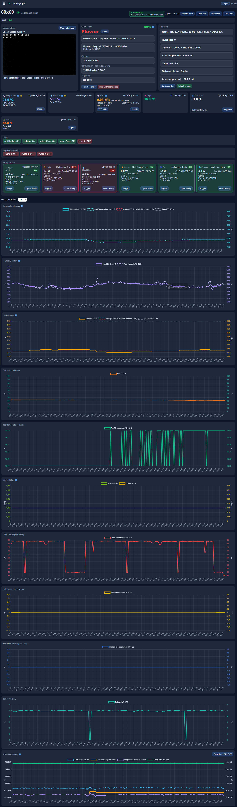
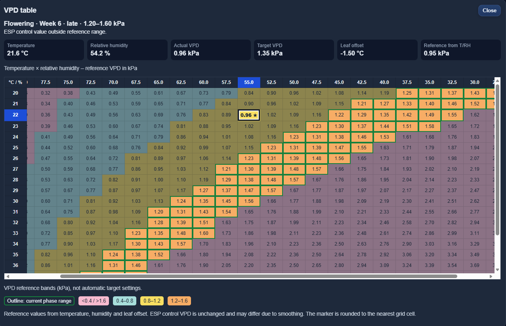

# GrowTent Backend (CanopyOps)

GrowTent Backend is a Docker-based backend and web UI for monitoring and operating one or more GrowTent controllers. It collects controller telemetry, stores history in PostgreSQL, provides dashboard charts and status cards, and offers control functions for compatible Shelly devices, relays, irrigation water pumps, and camera previews.

The project is intended for controller firmware/API versions compatible with the [GrowTent](https://github.com/syschelle/GrowTent) and [GrowTent-S3](https://github.com/syschelle/GrowTent-S3) controller projects. Basic functions such as Docker startup, login, setup, and configuration backup can work without a controller. Dashboard values, relay actions, Shelly data, camera previews, and irrigation actions depend on the endpoints and payload fields delivered by the connected controller.

## Dashboard overview

The dashboard combines camera preview, grow phase and dates, energy/cost totals, ESP-confirmed irrigation information, climate measurements, soil moisture, relay/Shelly states and history charts. Target edits, phase/date changes and irrigation actions are restricted to administrators; guests retain read-only monitoring.



The full-height screenshot shows the English interface on a classic eight-relay controller. ESP32-S3 controllers use their own six-channel pump/relay mapping. Displayed names, readings and addresses are examples.

---

## Table of contents

- [What this backend provides](#what-this-backend-provides)
- [VPD reference table](#vpd-reference-table)
- [Climate history and analysis export](#climate-history-and-analysis-export)
- [Architecture](#architecture)
- [Network and security model](#network-and-security-model)
- [Grow Profile adjustments (administrator)](#grow-profile-adjustments-administrator)
- [ESP-owned irrigation and synchronization](#esp-owned-irrigation-and-synchronization)
- [Irrigation hardware: normal water pumps](#irrigation-hardware-normal-water-pumps)
- [Compose files](#compose-files)
- [Environment and secrets](#environment-and-secrets)
- [Run with prebuilt images](#run-with-prebuilt-images)
- [Run with a local build](#run-with-a-local-build)
- [Initial installation and first setup](#initial-installation-and-first-setup)
- [Authentication, guests, and 2FA](#authentication-guests-and-2fa)
- [Admin recovery from Docker](#admin-recovery-from-docker)
- [Controller configuration](#controller-configuration)
- [Expected controller capabilities](#expected-controller-capabilities)
- [Shelly integration](#shelly-integration)
- [Camera and go2rtc integration](#camera-and-go2rtc-integration)
- [ESP Heap history: 24-hour diagnostic export](#esp-heap-history-24-hour-diagnostic-export)
- [Data storage, retention, backup, and restore](#data-storage-retention-backup-and-restore)
- [Useful URLs and API endpoints](#useful-urls-and-api-endpoints)
- [Operational checks](#operational-checks)
- [Troubleshooting](#troubleshooting)
- [Release information and validation](#release-information-and-validation)

---

## What this backend provides

GrowTent Backend is the central UI and API layer for a GrowTent installation.

Main features:

- dashboard for one or more tents/controllers
- live tiles for temperature, humidity, VPD, tank temperature, soil moisture, tank level, and device states
- historical storage of telemetry in PostgreSQL
- charts for temperature, humidity, VPD, soil moisture, alpha values, power usage, and system/storage metrics
- CSV/history access through backend API endpoints
- setup UI for tents, authentication, guests, appearance, language, units, and controller settings
- admin login and guest login modes
- optional two-factor authentication for admin access
- direct Shelly reads for fresher power and switch-state display
- optional Sensor.Community/Luftdaten DNMS-compatible live air sensor display
- up to three dedicated ESP8266 soil moisture sensor IPs per tent
- optional per-tent Growlight power-drop warning via Pushover with configurable Watt threshold; normal light-off transitions are ignored
- read-only live VPD reference table for administrators and guests, with phase/week highlighting
- ESP-owned irrigation planning, signed next-run confirmation and durable event-based notifications
- compact JSON analysis downloads for selected time ranges
- relay and irrigation actions for compatible controllers
- water-pump test actions for configured pump channels
- camera preview support through internal go2rtc access
- database-backed strain library with CSV seed/export support, genetics, THC/CBD, effects and aroma fields
- three pot strain assignments per tent in setup, displayed below the dashboard camera stream with clickable strain detail popovers and live climate metrics in fullscreen preview
- configuration export/import
- Docker CLI helper for admin credential recovery
- first-start install page/API for creating the initial admin account

---


### Security defaults

The API host port is bound to loopback by default:

```yaml
${GT_API_BIND_ADDRESS:-127.0.0.1}:8088:8080
```

This prevents direct LAN/Internet access to port 8088 unless you explicitly change `GT_API_BIND_ADDRESS`. Prefer exposing the application through an HTTPS reverse proxy. If direct LAN access is intentionally required, set `GT_API_BIND_ADDRESS=0.0.0.0` and protect the port with the host/network firewall.

Session cookies use the `Secure` flag by default (`SESSION_COOKIE_SECURE=true`). Set `SESSION_COOKIE_SECURE=false` only for an intentional plain-HTTP local deployment; HTTPS is recommended.

Project ZIP download is disabled by default (`PROJECT_DOWNLOAD_ENABLED=false`). If explicitly enabled, it is administrator-only and excludes `.env`, `.env.*`, private keys and similar secret material.

**Login is mandatory for all application content.** Unauthenticated visitors see only the sign-in page (and, before first installation, the token-protected initial setup). Dashboard, cameras, JSON/ZIP exports, API responses, GrowGuide, and even `/health` require a valid login session. Guest accounts remain signed-in read-only users; administrative endpoints require an administrator. The former anonymous read-only mode has been removed and cannot be re-enabled in Setup or via the API.

## VPD reference table

Open **VPD table / VPD-Tabelle** from the VPD tile. This read-only dialog is available to guests and administrators; it does not change ESP settings, phase/week assignments or target values.



The table covers 20–40 °C and 25–85% relative humidity in 2.5-percentage-point humidity steps. It displays exact current temperature, humidity, **Actual VPD / IST-VPD**, target VPD, leaf offset and a separately calculated reference from temperature/humidity. Reference cells use the ESP-compatible saturation-pressure calculation with the configured leaf offset, without advancing any control filter.

The current valid reading highlights the nearest grid cell, temperature row and humidity column. The marker is rounded to the grid; the actual ESP regulation value remains the authoritative measurement and may differ from the calculated reference because of smoothing. Missing offsets leave reference cells unavailable. Invalid, stale, missing or out-of-range readings do not receive an active marker.

Phase/week metadata from the existing ESP snapshot selects the outlined reference band:

| ESP phase | Weeks 1–2 | Week 3 onward |
| --- | --- | --- |
| Vegetative | 0.4–0.8 kPa | 0.8–1.2 kPa |
| Flowering | 0.8–1.2 kPa | 1.2–1.6 kPa |
| Drying, unknown phase/week or stale data | No phase band | No phase band |

Extended phases retain their own late-phase band until the ESP phase actually changes. There are no week-mapping controls or browser overrides. These are display references, not automatic targets. Colour bands follow the displayed two-decimal reference value, including 1.60 kPa in the upper reference band. The VPD tile also shows a compact reference-range assessment when valid data is available.

The dialog reuses existing latest-state data, with no extra ESP/Shelly polling or write requests. It supports German/English, Celsius/Fahrenheit labels, keyboard close and mobile scrolling. Guest access to the table does not grant target-editing privileges.

## Climate history and analysis export

### ESP-owned VPD channel

The VPD tile, fullscreen camera metric, VPD history, statistics and history exports use `sensors.cur.vpdKpa` from the ESP. The backend does not recalculate or smooth that measurement from temperature/humidity or replace it with raw/older readings. Missing, invalid or explicitly stale climate data produces `null` and a chart gap. Raw VPD remains a separate diagnostic value; compatibility smoothed-VPD fields alias the control value.

Stored history is not rewritten. Old samples already synthesized by an older backend cannot retrospectively prove ESP provenance; no historical backfill is attempted. `backend.vpd.source` identifies channel selection, not cryptographic provenance.

### Chart ranges

**Setup → Charts** stores browser-local axis preferences shared across tents in that browser:

- Temperature: half-span around the target in °C, converted for °F; default ±5 °C.
- Humidity: total minimum span in percentage points; default 10, shifted within 0–100% near the edges.
- VPD: total minimum span in kPa around the target; default automatic.

Zero selects automatic scaling. Missing targets use the midpoint of valid plotted readings. Axes expand for larger excursions. Preferences apply on the next refresh and are not included in server backups or synchronized to other browsers; measurements, statistics and exports stay unchanged.

### JSON analysis download

**Export JSON / JSON exportieren** opens a period selector for 1, 6, 12, 24 or 48 hours (default 24 hours) and downloads a compact `.json` attachment suitable for analysis with tools such as ChatGPT. Nothing is uploaded automatically.

`GET /api/export/analysis?tent_id=<id>&range=24h` reads existing stored history. The `growtent.analysis.v1` format includes windowed average/minimum/maximum/valid sample counts for control/raw climate measurements, humidifier and exhaust power (`metrics.exhaust_watt`, in W) and adaptive smoothing factors. Targets, including leaf offset, retain first/last values and observed changes; gaps and omitted event details are explicitly reported. Unknown/stale values remain unknown.

The export includes structured `grow_phase` metadata (phase, week, early/late stage, German/English labels and VPD table reference limits) for the last historical observation and each homogeneous measurement window. Mixed windows have `grow_phase_counts`; missing information is not backfilled. See [analysis export schema](docs/analysis-export.md).

Default windows are 2 minutes, or 4 minutes for 48 hours, with at most 720 points. If required, windows widen to keep the UTF-8 file within 1,000,000 bytes; `sizeAdapted` and `bucketSeconds` describe the result. Observed switch changes are backend samples, not exact physical event timestamps; short pulses between polls may be missed. Sampling gaps break switch continuity. Downloads exclude IP addresses, secrets and original payloads.

Each analysis point may contain `external_temperatures` (the historical DS18B20 `sensor_name`, `avg`, `min`, `max`, `n` in °C); a renamed sensor is never merged with a differently named one. The top-level `irrigation_events` list contains stored ESP journal events, original UTC and Europe/Berlin occurrence timestamps, receipt time, event type and export-local `run_ref`. Events with no valid ESP clock retain a null occurrence time and are selected by receipt time. `configured_amount_ml` and `observed_settings` come from the closest preceding historical sample within max(60 seconds, 3 poll intervals); `measured_amount_ml` is null because the current firmware does not report actual dispensed volume. Do not sum configured amounts across start/end events. Context includes historical irrigation settings and the ESP-reported last-run calendar date, not a reconstructed timestamp. Events absent from the ESP journal (e.g. some legacy or individual pump actions) are not invented. The export never substitutes current settings for missing history. If exact journal data cannot fit in 1 MB even at maximum aggregation, select a shorter interval (HTTP 413).

Existing `/api/export` and `/api/history` retain their 50-sample schemas. History points include `temperature_target` in °C and `vpd_target` in kPa from the same stored sample; missing historical targets remain null instead of inheriting today's setting.

---

## Architecture

The default Docker stack contains three services.

| Service | Container | Purpose | Host exposure |
|---|---|---|---|
| API/UI | `gt_api` | FastAPI app, web UI, authentication, proxy/helper endpoints | yes, default `127.0.0.1:8088:8080` |
| PostgreSQL | `gt_db` | persistent configuration and history database | no |
| go2rtc | `gt_go2rtc` | internal camera/RTSP helper | no |

Normal browser access:

Prefer the public HTTPS URL of your reverse proxy. Direct `http://<server-ip>:8088` access requires an explicitly non-loopback `GT_API_BIND_ADDRESS`; plain-HTTP login sessions also require `SESSION_COOKIE_SECURE=false`.

```text
http://127.0.0.1:8088
```

Common pages:

```text
http://<server-ip>:8088/app?page=dashboard
http://<server-ip>:8088/setup
http://<server-ip>:8088/changelog
http://<server-ip>:8088/health
```

The API polls configured controllers, stores readings, serves the web UI, and forwards selected actions to the controller. PostgreSQL is used for persistent configuration and time-series history. go2rtc is used only as an internal helper for camera preview/stream handling.

---

## Grow Profile adjustments (administrator)

On the selected tent dashboard, the **Adjust / Anpassen** action within the status tile opens a modal over the current dashboard, like the Irrigation Plan editor. CanopyOps navigation and the camera view remain in context; closing the dialog returns to the same tent.

The dashboard modal has compact aligned controls and a content-sized height, while preserving touch-friendly input rows on small screens.

The action is visible only to administrators while the controller is online (`Status: OK`) and the per-tent Backend Write API is fully configured in Setup (enabled, controller URL and HMAC secret). Target temperature and VPD also have compact **change / ändern** dialogs directly on their measurement tiles. The **Adjust / Anpassen** dialog beside the phase handles phase and dates. Each Grow Profile setting has its own **Send** action. Temperature uses 0.5 °C increments. Target VPD uses 0.01 kPa increments and two decimal places, within 0.50–3.50 kPa. Flowering and drying dates can only be explicitly deleted via JSON `null`.

The backend signs writes using HMAC-SHA256 and confirms both stored and runtime controller values before showing success. Guests cannot see the action or modal and receive HTTP 403 for the Grow Profile editor and write API. No extra controller polling runs while the modal is closed.

Existing deep links to `/app?page=grow-profile&tent=<id>` continue to work for administrators, but the dashboard action itself stays within the selected dashboard.

---

## Network and security model

By default, only the API/web UI should be reachable from outside Docker.

| Component | Internal address | Published host port | Notes |
|---|---:|---:|---|
| API/UI | `api:8080` | `127.0.0.1:8088:8080` by default | loopback-only unless `GT_API_BIND_ADDRESS` is overridden |
| PostgreSQL | `db:5432` | none | Docker-network only |
| go2rtc HTTP/API | `go2rtc:1984` | none | Docker-network only |
| go2rtc RTSP | `go2rtc:8554` | none | Docker-network only |

This means:

- by default only the host itself can use `http://127.0.0.1:8088`; use an HTTPS reverse proxy for remote clients
- the API reaches PostgreSQL internally via `db:5432`
- the API reaches go2rtc internally via `http://go2rtc:1984`
- PostgreSQL is not intended to be reachable directly from the host or LAN
- go2rtc ports `1984` and `8554` are not intended to be reachable directly from the host or LAN

Verify published ports after startup:

```bash
docker port gt_api
docker port gt_go2rtc
docker port gt_db
ss -tulpn | grep -E ':8088|:1984|:8554|:5432' || true
```

Expected result for the default stack:

```text
8080/tcp -> 127.0.0.1:8088
```

`docker port gt_go2rtc` and `docker port gt_db` should print no published ports. In `ss`, only `8088` should appear for this stack.

If `1984` or `8554` still appear, an old container may still exist or the active Compose file still contains old `ports:` entries for go2rtc. See [go2rtc ports are still visible](#go2rtc-ports-are-still-visible).

### Binding the API to localhost only

If the API should only be reachable from the Docker host itself, change the API port mapping to:

```yaml
ports:
  - "127.0.0.1:8088:8080"
```

For intentional direct LAN access, set `GT_API_BIND_ADDRESS` to the host's LAN address or `0.0.0.0` in `.env` and restrict access through the host/network firewall. Keep the loopback default when using a host-based HTTPS reverse proxy.

---

## ESP-owned irrigation and synchronization

The ESP is the only automatic irrigation scheduler. The backend edits the controller's persistent plan through HMAC, retains manual full-cycle requests and sends Pushover notifications from durably ingested ESP events. Use compatible firmware supporting the signed plan/event protocol, idempotent manual starts and next-run metadata; basic telemetry alone is insufficient.

In Setup, enable Backend Write API for the tent, set the controller URL (normally `http://<esp-ip>:8080`) and enter the same 64-character hexadecimal secret configured on the ESP. The ESP must allow the TCP source IPv4 address it actually sees; with Docker NAT this is commonly the Docker host's LAN IP. HMAC provides authentication, integrity and replay protection; HTTP traffic is not encrypted.

Open **Irrigation plan / Bewässerungsplan**, review the ESP's confirmed settings or explicitly load and review a previous backend snapshot, then save. The ESP retains authority over timing, Drying, enabled pumps, Flood interlocks, storage and overlap checks. Independent backend automatic scheduling must remain disabled.

The dashboard shows the signed ESP next-run forecast for both six- and eight-relay layouts. Disabled, unavailable and stale states are labelled; the backend neither guesses a replacement date nor triggers automatic watering. Known last-watering history is transferred only from available records, never estimated.

Signed plan confirmation and event/ACK errors are independent. An event warning does not invalidate an otherwise confirmed plan; offline/authentication failures remain read-only and display diagnostics. Confirmation times are displayed in Europe/Berlin. A queued/accepted manual command is not evidence of physical completion: the backend tracks its durable command identity and event result, without unsigned legacy fallback.

See [TESTING.md](TESTING.md) and [SECURITY.md](SECURITY.md) for delivery semantics and open device validation.

---

## Irrigation hardware: normal water pumps

The irrigation features are designed for **normal water pumps** switched by suitable relays, power supplies, and electrical protection.

Use normal water pumps for irrigation channels. Do not plan the system around dosing pump behavior. The backend and dashboard assume that a pump channel can reliably move water when the corresponding relay/action is active.

Hardware recommendations:

- use relay outputs only within their rated voltage and current limits
- use a pump power supply sized for startup current, not only nominal running current
- protect pumps from dry-running
- prevent backflow and siphoning through mechanical layout or check valves
- keep water and mains voltage strictly separated
- use proper fusing, strain relief, cable gauges, and enclosures
- test each pump manually only after the tank, tubing, and drainage path are safe
- use the 10-second pump test action only for short functional checks

In the UI/API, pump and irrigation channels refer to normal water pumps connected to the appropriate relay or controller output.

---

## Compose files

The repository contains two Compose files for different use cases.

### `docker-compose.images.yml`

Recommended for normal operation. The API service uses a prebuilt container image instead of building Python code on the target host.

Advantages:

- fast startup on Raspberry Pi and x86 servers
- no local Python build environment required
- one deployment file for ARM64 and AMD64 systems
- deterministic operation when a fixed image tag is used

Default API image:

```text
ghcr.io/syschelle/growtent-backend-api:latest
```

Pinned image example (replace `YOUR_RELEASE_TAG` with an existing published release tag):

```text
ghcr.io/syschelle/growtent-backend-api:YOUR_RELEASE_TAG
```

The go2rtc helper image is pinned by default as well, instead of using a moving `latest` tag:

```text
alexxit/go2rtc:1.9.14@sha256:f0579db234b4f9e8630493777dbf8581630d5d942d27b884ac9186f3d688e7bf
```

Override it only deliberately, for example during controlled testing:

```bash
GO2RTC_IMAGE=alexxit/go2rtc:1.9.14@sha256:f0579db234b4f9e8630493777dbf8581630d5d942d27b884ac9186f3d688e7bf docker compose -f docker-compose.images.yml up -d --force-recreate go2rtc
```

### `docker-compose.yml`

Recommended for local development or testing from source. The API image is built from `./api`.

```bash
docker compose up -d --build
```

For production-style operation, prefer `docker-compose.images.yml`.

---

## Environment and secrets

Both Compose files require deployment-specific database credentials through a `.env` file. They intentionally do not contain usable default database passwords. This avoids accidentally copying weak example credentials into a real installation.

Create the file from the template:

```bash
cp .env.example .env
```

Then edit `.env` and replace every `REPLACE_WITH_*` value with a strong random secret. Do not commit `.env` and do not reuse the placeholder values.

Required values include:

```text
POSTGRES_DB=<database-name>
POSTGRES_USER=<database-user>
POSTGRES_PASSWORD=<strong-random-database-password>
DATABASE_URL=postgresql://<database-user>:<url-encoded-database-password>@db:5432/<database-name>
INSTALL_API_TOKEN=<strong-random-first-run-install-token>
GT_DATA_ENCRYPTION_KEY=<unique-urlsafe-base64-32-byte-key>
```

Use different secrets for each deployment. If the database password contains special characters, URL-encode it in `DATABASE_URL`.

The application refuses to start with missing, placeholder, or known weak default database URLs. **From v0.413, the API also refuses startup without a valid `GT_DATA_ENCRYPTION_KEY`.** The key is required by both Compose variants.

Generate the 32-byte Fernet key **once**, and store it separately from the database:

```bash
# On a host with Python and cryptography installed:
python3 -c 'from cryptography.fernet import Fernet; print(Fernet.generate_key().decode())'
# Alternative using standard OpenSSL:
openssl rand -base64 32 | tr '+/' '-_'
```

Put the generated string on a single `GT_DATA_ENCRYPTION_KEY=...` line in `.env`, then protect that file (`chmod 600 .env`). Keep the key in an independent offline secret vault or password manager. **Do not change the key after first boot**, even for restores: it is needed to read encrypted PostgreSQL fields and config backups. An existing installation migrates its plaintext TOTP, Pushover, Gromate, Shelly/HMAC and RTSP credentials automatically on its first v0.413 start. A wrong key prevents access. Before upgrading, retain a separate pre-migration DB backup for a possible rollback; the migrated database cannot be used with v0.412 without restoring the old snapshot.

Generate example random values on Linux:

```bash
openssl rand -base64 36
openssl rand -base64 48
```

---

## Run with prebuilt images

Create or enter the project directory on the target host:

```bash
cd /opt/growtent-backend
```

Create and edit the required `.env` file before starting the stack:

```bash
cp .env.example .env
nano .env
```

Pull images:

```bash
docker compose -f docker-compose.images.yml pull
```

Start the stack:

```bash
docker compose -f docker-compose.images.yml up -d --remove-orphans
```

The image-based Compose file defaults to the moving latest image. You can also pin a release explicitly; replace `YOUR_RELEASE_TAG` with an existing published release tag:

```bash
GT_API_IMAGE=ghcr.io/syschelle/growtent-backend-api:YOUR_RELEASE_TAG docker compose -f docker-compose.images.yml pull
GT_API_IMAGE=ghcr.io/syschelle/growtent-backend-api:YOUR_RELEASE_TAG docker compose -f docker-compose.images.yml up -d --remove-orphans
```

Check status:

```bash
docker compose -f docker-compose.images.yml ps
curl -i http://127.0.0.1:8088/health
```

Open the UI:

```text
http://<server-ip>:8088/app?page=dashboard
```

Open setup:

```text
http://<server-ip>:8088/setup
```

### Private GHCR package access

If the container registry package is private, log in on the server before pulling images:

```bash
echo "$CR_PAT" | docker login ghcr.io -u syschelle --password-stdin
```

The token needs package read access.

---

## Run with a local build

For local development or a source-based install:

```bash
cd /opt/growtent-backend
docker compose up -d --build
```

Check the API:

```bash
curl -i http://127.0.0.1:8088/health
```

---

## Initial installation and first setup

On a fresh installation, before an admin password exists, open:

```text
http://<server-ip>:8088/install
```

The initial installation page creates the first administrator account. It asks for:

- admin username
- admin password
- password confirmation
- install token from `.env` (`INSTALL_API_TOKEN`)

After the first admin password is stored, the install page/API is no longer available. Requests to the install API then return `404`, so the bootstrap endpoint cannot be reused for later credential changes.

Initial install API endpoints:

```text
GET  /api/install      available only before the first admin password exists
POST /api/install      creates the initial admin account and enables authentication
```

The install API is protected by `INSTALL_API_TOKEN` by default. The token must be provided as the `X-Install-Token` request header for `POST /api/install`. It is not accepted in URLs or request bodies.

The install API can be disabled completely with the environment variable:

```text
INSTALL_API_ENABLED=false
```

For development-only environments, token enforcement can be disabled with:

```text
INSTALL_API_REQUIRE_TOKEN=false
```

After the initial admin account has been created, continue with the normal setup page:

```text
http://<server-ip>:8088/setup
```

Typical first setup tasks:

1. sign in with the admin account created during initial installation
2. optionally enable two-factor authentication
3. add one or more tent/controller entries
4. configure controller base URLs
5. configure display name, language, units, and appearance
6. configure optional guest accounts
7. configure Shelly/controller features if available
8. verify the dashboard receives live data

The setup page includes authentication settings, tent configuration, guest configuration, appearance options, backup/import tools, and operational helper links.

---

## Authentication, guests, and 2FA

The backend supports:

- multiple independent administrator accounts
- optional per-administrator 2FA with TOTP and separate recovery codes
- automatic migration of the legacy single-admin configuration without changing the existing password hash or TOTP secret
- guest accounts
- guest-specific UI restrictions
- per-user UI preferences for selected display options

Important administrator behavior:

- on a fresh database, admin login is blocked until the initial install page creates the first admin account
- additional administrators can be created and managed in Setup
- Setup manages username, password, active state, 2FA and recovery codes directly on each administrator card; there is no separate global 2FA editor
- the legacy single-admin fields remain only as an internal rollback compatibility mirror and are no longer shown as editable admin credentials
- each administrator can independently use password-only login or enable their own TOTP 2FA
- the last active administrator cannot be disabled or deleted
- upgrades from the legacy single-admin layout migrate the existing single admin automatically and preserve its password hash, TOTP secret and recovery-code hashes
- old configuration backups without an `admins` section are restored as a single administrator and migrated automatically
- after the first admin password exists, `/install` and `/api/install` return `404`
- leaving the password field empty keeps the current password unchanged
- entering a new password changes the admin password
- password confirmation must match before a password change is saved
- the setup UI trims the admin username before validation and saving
- the password itself is not trimmed; leading/trailing spaces are treated as part of the password
- admin passwords, guest passwords, and 2FA recovery codes are stored as Argon2id hashes
- legacy password hash formats are intentionally not accepted or migrated; reset the admin password with `manage_auth.py` if an older database no longer accepts the previous password

Guest mode is intended for restricted dashboard access. Server-side restrictions still apply even if UI elements are hidden.

---

## Admin recovery from Docker

The API image includes `manage_auth.py` for recovery and inspection from inside the API container.

Show auth status:

```bash
docker exec -it gt_api python /app/manage_auth.py status
```

Reset the password while preserving the currently configured admin username:

```bash
printf '%s' '<new-admin-password>' | docker exec -i gt_api python /app/manage_auth.py set-admin --password-stdin --disable-2fa
```

Set username and password explicitly:

```bash
printf '%s' '<new-admin-password>' | docker exec -i gt_api python /app/manage_auth.py set-admin --username 'admin' --password-stdin --disable-2fa
```

With Compose:

```bash
printf '%s' '<new-admin-password>' | docker compose -f docker-compose.images.yml exec -T api python manage_auth.py set-admin --password-stdin --disable-2fa
```

Use `--disable-2fa` when you are locked out because the previous TOTP secret is unavailable.

---

## Controller configuration

Each tent/controller entry typically needs:

- display name
- base URL of the controller
- optional camera/stream settings
- optional Shelly configuration
- optional irrigation plan
- optional exhaust/VPD plan

The backend expects the controller to expose compatible endpoints for state, stats, relay actions, Shelly data, and irrigation actions. If an endpoint is missing or returns a different payload structure, the dashboard may show partial data or mark the tent as delayed/offline.

Controller availability is monitored by polling. The polling interval can be configured with:

```text
POLL_INTERVAL_SECONDS=10
```

History retention can be configured with:

```text
RETENTION_DAYS=7
```

---

## Expected controller capabilities

The UI and API are most useful when the controller provides telemetry such as:

- current temperature
- current relative humidity
- VPD values
- tank temperature
- tank fill/level information
- relay states
- irrigation state
- pump/watering run status
- system/storage metrics
- Shelly state/power information, if Shelly integration is used

Common backend endpoints that depend on controller data:

```text
GET  /tents/{tent_id}/latest
GET  /tents/{tent_id}/history
GET  /tents/{tent_id}/preview
POST /tents/{tent_id}/actions/relay/{relay_idx}/toggle
POST /tents/{tent_id}/actions/startWatering
POST /tents/{tent_id}/actions/pump/{pump_idx}/trigger10s
POST /tents/{tent_id}/actions/pingTank
```

For irrigation pump actions, `pump_idx` is the physical relay index used by the controller. Legacy 8-relay controllers use relays 6/7/8 for pumps 1/2/3, while ESP32-S3-Relay-6Ch controllers use relays 1/2/3. The `irrigation.pump1.enabled` through `irrigation.pump3.enabled` state flags always refer to the logical pump number and are independent of the physical relay number.

If a controller is unreachable, the dashboard should continue to serve the UI but may display stale/offline status for the affected tent.

---

## Shelly integration

Shelly support is used for switch state, power readings, energy readings, and schedule visibility where compatible data is available.

The dashboard can read Shelly data directly through backend helper endpoints, which helps avoid stale controller snapshots. Typical endpoints include:

```text
GET  /tents/{tent_id}/shelly/main/direct
GET  /tents/{tent_id}/shelly/exhaust/direct
GET  /tents/{tent_id}/shelly/direct-all
POST /tents/{tent_id}/actions/shelly/{device}/toggle
POST /tents/{tent_id}/actions/shelly/reset-energy
```

Shelly data quality depends on the configured Shelly addresses, controller settings, and network reachability from the backend/controller environment.

Shelly credential handling:

- `shelly_main_password` may be submitted when creating or updating a tent.
- Tent list/create/update responses do not return the stored plaintext password.
- Responses expose only `has_shelly_main_password` so clients can show whether a password is configured.
- When editing a tent, leave the Shelly password field empty to keep the existing stored password.
- Send `shelly_main_password_clear: true` in an update payload only if the stored Shelly password should be removed.

---

## Camera and go2rtc integration

The stack includes go2rtc as an internal camera helper.

Default internal URL used by the API:

```text
GO2RTC_BASE_URL=http://go2rtc:1984
```

go2rtc is intentionally not published to the host by default. The browser should access camera previews through the API/UI path, not by directly opening `:1984` or `:8554` on the host.

The Compose files pin go2rtc to an immutable image reference by default:

```text
alexxit/go2rtc:1.9.14@sha256:f0579db234b4f9e8630493777dbf8581630d5d942d27b884ac9186f3d688e7bf
```

This avoids silently pulling a newer upstream `latest` image with changed behavior or newly introduced vulnerabilities.

Related endpoint:

```text
GET /tents/{tent_id}/preview
```

If camera preview is unavailable:

- verify the controller/camera stream configuration
- verify `gt_go2rtc` is running
- verify `GO2RTC_BASE_URL` points to `http://go2rtc:1984`
- verify the API can reach go2rtc inside the Docker network

---

## ESP Heap history: 24-hour diagnostic export

For heap/fragmentation investigations, open the **dashboard of the affected tent** and scroll to **ESP Heap history / ESP-Heap Verlauf**. Administrators see **Download 24h CSV / 24h CSV herunterladen** beside the chart title. The action works on mobile as well as desktop and is independent of the currently selected chart range.

The downloaded file `growtent-heap-tent-<id>-24h-<UTC>.csv` contains all available successful controller polls in the **preceding 24 hours**. Each line includes the UTC capture timestamp, ESP uptime in seconds (useful for detecting reboots), free heap, minimum free heap, largest free block, total heap size (all in bytes), and the largest-free-block/free-heap ratio. Missing values remain blank; gaps in polling remain visible as timestamp gaps. These are unfiltered observations from PostgreSQL, not chart-smoothed values. Existing `tent_state` retention is 7 days by default, so this export requires **no new firmware, controller polling, or migration**. Data from before telemetry collection started cannot be reconstructed.

The download endpoint is `GET /tents/{tent_id}/heap/export.csv` and requires an authenticated administrator session. The CSV contains no HMAC secrets, Shelly credentials, or unrelated sensor values. Download each affected tent separately and share those files for a side-by-side heap trend analysis.

---

## Data storage, retention, backup, and restore

PostgreSQL stores application configuration, history, pot strain assignments, and the strain library. The bundled `data/strains.csv` is used as an initial seed only when the database strain table is empty.

The CSV header is:

```csv
Name,Genetics,THC,CBD,Effects,Aroma
```

Admins can edit these records in the Strains tab. Guest users can view the strain library but cannot edit it. The Strains page localizes UI labels according to the selected UI language, while strain values are displayed unchanged. `GET /strains.csv` downloads a live CSV export generated from the database. Admins can import the same CSV format again from the Strains page, for example to transfer the library to another instance. The import merges by strain name: missing records are created, matching records are updated, unchanged records stay untouched, and records not present in the CSV are not deleted. Existing bundled CSV data is imported into PostgreSQL on startup only when the database strain table is empty.

Setup stores optional per-tent assignments for three pots as `pot_strains_json` in PostgreSQL. These assignments reference strain names from the database-backed strain library and are included in configuration backup/restore.

The included Compose files use a named Docker volume:

```yaml
volumes:
  db_data:
```

If you customize the Compose file to use a bind mount such as `./data/postgres:/var/lib/postgresql/data`, remember that PostgreSQL initialization variables only apply when the data directory is empty.

### Configuration backup through the UI/API

Export configuration:

```text
GET /config/backup/export
```

Import configuration:

```text
POST /config/backup/import
```

The setup page also provides backup/import controls.

**v0.413 security:** Configuration backup exports are encrypted `.encrypted.json` files, not plain JSON. They contain the complete configuration, including RTSP camera URLs, Shelly passwords, HMAC secrets, administrators/2FA seeds and notification credentials **only inside authenticated ciphertext**. The encryption key is NOT embedded and is required on the target host before importing. The existing administrator password/TOTP step-up confirmation is required for export/import.

Legacy plaintext JSON backups remain importable to help migrate older installations, but are highly sensitive and should be protected or securely destroyed once migrated. `pg_dump`/restic snapshots still require independent storage access controls: old snapshots can retain historical plaintext data and the encrypted database remains useless without its separately stored encryption key.

### Database backup with pg_dump

Create a PostgreSQL dump:

```bash
docker exec gt_db sh -lc 'pg_dump -U "$POSTGRES_USER" -d "$POSTGRES_DB"' > growtent-backup.sql
```

Restore a dump:

```bash
cat growtent-backup.sql | docker exec -i gt_db sh -lc 'psql -U "$POSTGRES_USER" -d "$POSTGRES_DB"'
```

### Named volume backup

For full-volume backup, stop the stack first or ensure a consistent snapshot mechanism. Database-level backups with `pg_dump` are usually easier and safer for normal operations.

---

## Useful URLs and API endpoints

Browser pages:

```text
/                         redirect/helper entry
/install                  initial admin account bootstrap page; first start only
/app?page=dashboard       main app shell/dashboard
/setup                    setup UI
/changelog                changelog page
/grow-guide               grow guide page
/poll-errors              poll error page
/health                   health endpoint
```

Authentication/config:

```text
GET  /api/install       initial install status; first start only
POST /api/install       create initial admin account; first start only
GET  /auth/whoami
POST /auth/login
POST /auth/login/2fa
POST /auth/logout
GET  /config/auth
POST /config/auth
POST /config/auth/2fa
POST /config/auth/2fa/verify
GET  /config/air-sensor
POST /config/air-sensor
GET  /air-sensor/current
GET  /config/guests
POST /config/guests
PUT  /config/guests/{guest_id}
DELETE /config/guests/{guest_id}
```

Tent data and actions:

```text
GET  /tents
POST /tents
PUT  /tents/{tent_id}
GET  /tents/{tent_id}/latest
GET  /tents/{tent_id}/history
GET  /tents/{tent_id}/preview
GET  /tents/{tent_id}/irrigation-plan
PUT  /tents/{tent_id}/irrigation-plan
GET  /tents/{tent_id}/exhaust-vpd-plan
PUT  /tents/{tent_id}/exhaust-vpd-plan
POST /tents/{tent_id}/actions/relay/{relay_idx}/toggle
POST /tents/{tent_id}/actions/startWatering
POST /tents/{tent_id}/actions/pump/{pump_idx}/trigger10s
POST /tents/{tent_id}/actions/pingTank
```

Shelly helpers:

```text
GET  /tents/{tent_id}/shelly/last-switches
GET  /tents/{tent_id}/shelly/main/direct
GET  /tents/{tent_id}/shelly/exhaust/direct
GET  /tents/{tent_id}/shelly/direct-all
POST /tents/{tent_id}/actions/shelly/{device}/toggle
POST /tents/{tent_id}/actions/shelly/reset-energy
```

---

## Operational checks

After startup:

```bash
docker compose -f docker-compose.images.yml ps
curl -i http://127.0.0.1:8088/health
```

Check logs:

```bash
docker logs --tail=100 gt_api
docker logs --tail=100 gt_db
docker logs --tail=100 gt_go2rtc
```

Check published ports:

```bash
docker port gt_api
docker port gt_go2rtc
docker port gt_db
ss -tulpn | grep -E ':8088|:1984|:8554|:5432' || true
```

Inspect the active Compose configuration:

```bash
docker compose -f docker-compose.images.yml config
```

Inspect the Compose file and port bindings used for a running container:

```bash
docker inspect gt_go2rtc --format 'Project={{index .Config.Labels "com.docker.compose.project"}} Files={{index .Config.Labels "com.docker.compose.project.config_files"}} Service={{index .Config.Labels "com.docker.compose.service"}} PortBindings={{json .HostConfig.PortBindings}}'
```

---

## Troubleshooting

### API port 8088 is not visible

Check whether the API container is running:

```bash
docker compose -f docker-compose.images.yml ps
docker logs --tail=100 gt_api
```

Check whether the Compose config contains the API port mapping:

```bash
docker compose -f docker-compose.images.yml config | grep -A30 "api:"
```

Expected API mapping:

```yaml
ports:
  - mode: ingress
    target: 8080
    published: "8088"
```

If an old container exists, recreate it:

```bash
docker compose -f docker-compose.images.yml rm -sf api
docker compose -f docker-compose.images.yml up -d api
```

or:

```bash
docker rm -f gt_api
docker compose -f docker-compose.images.yml up -d --force-recreate api
```

### go2rtc ports are still visible

If `docker port gt_go2rtc` still shows `1984` or `8554`, the container was created from an old Compose configuration or another Compose file is still publishing the ports.

Search for old port mappings:

```bash
grep -Rni --include='*.yml' --include='*.yaml' -E '1984|8554|go2rtc|ports:' .
```

The `go2rtc` service should not contain `ports:`. It may contain only `expose:` or no port declaration at all:

```yaml
go2rtc:
  restart: unless-stopped
  image: "${GO2RTC_IMAGE:-alexxit/go2rtc:1.9.14@sha256:f0579db234b4f9e8630493777dbf8581630d5d942d27b884ac9186f3d688e7bf}"
  container_name: gt_go2rtc
  expose:
    - "1984"
    - "8554"
```

Recreate the stack:

```bash
docker compose -f docker-compose.images.yml down --remove-orphans
docker rm -f gt_go2rtc gt_api gt_db 2>/dev/null || true
docker compose -f docker-compose.images.yml up -d --force-recreate --remove-orphans
```

Verify again:

```bash
docker port gt_go2rtc
ss -tulpn | grep -E ':1984|:8554' || true
```

### GHCR pull returns `denied`

Typical causes:

- the image package is private
- the server is not logged in to GHCR
- the image name is wrong
- the requested tag does not exist

Login example for private packages:

```bash
echo "$CR_PAT" | docker login ghcr.io -u syschelle --password-stdin
```

Then retry:

```bash
docker compose -f docker-compose.images.yml pull
```

### GHCR pull returns `manifest unknown`

The requested tag does not exist in the registry or has not been published yet.

Check which image is requested:

```bash
docker compose -f docker-compose.images.yml config | grep image:
```

Use a tag that actually exists, preferably a pinned release tag:

```bash
GT_API_IMAGE=ghcr.io/syschelle/growtent-backend-api:YOUR_RELEASE_TAG docker compose -f docker-compose.images.yml pull
```

### Initial install page is not available

The `/install` page and `/api/install` endpoint are available only before the first admin password has been stored. This is expected after installation is complete.

Check auth status from inside the API container:

```bash
docker exec -it gt_api python /app/manage_auth.py status
```

If an admin password already exists, use the normal login page or the Docker recovery helper.

If this is a fresh test system and no data needs to be kept, recreate the database volume and start again:

```bash
docker compose -f docker-compose.images.yml down -v
docker compose -f docker-compose.images.yml up -d
```

Warning: `down -v` deletes the database volume for this stack.

If the install API should be disabled even on fresh systems, set:

```text
INSTALL_API_ENABLED=false
```

### PostgreSQL says `role "growtent" does not exist`

This usually means the database volume was initialized previously with different credentials or roles.

For a fresh installation where no data needs to be kept, recreate the database volume:

```bash
docker compose -f docker-compose.images.yml down -v
docker compose -f docker-compose.images.yml up -d
```

Warning: `down -v` removes named volumes and deletes the database data for this stack.

For an existing installation where data must be kept, inspect the available roles first:

```bash
docker exec -it gt_db sh -lc 'psql -d postgres -c "\du"'
```

Then repair the database role with the correct superuser for that database.

### PostgreSQL password changes do not take effect

`POSTGRES_USER`, `POSTGRES_PASSWORD`, and `POSTGRES_DB` are used by the PostgreSQL image only when the database directory is initialized for the first time. They do not rewrite an existing database volume.

If you change credentials in Compose after the database has already been initialized, update the database role itself or recreate the database volume.

### API startup fails with database connection errors

Check API logs:

```bash
docker logs --tail=100 gt_api
```

Check database health:

```bash
docker compose -f docker-compose.images.yml ps db
docker logs --tail=100 gt_db
```

Check the API database URL:

```bash
docker exec gt_api python -c 'import os; print("DATABASE_URL configured:", bool(os.environ.get("DATABASE_URL")))'
```

There is no safe default database URL. The value must come from your deployment-specific `.env` file and should match your `POSTGRES_DB`, `POSTGRES_USER`, and `POSTGRES_PASSWORD` settings.

### Admin login no longer works

Reset the admin password from Docker:

```bash
printf '%s' '<new-admin-password>' | docker exec -i gt_api python /app/manage_auth.py set-admin --password-stdin --disable-2fa
```

Check the configured username:

```bash
docker exec -it gt_api python /app/manage_auth.py status
```

If the username was changed, either log in with that username or set it explicitly:

```bash
printf '%s' '<new-admin-password>' | docker exec -i gt_api python /app/manage_auth.py set-admin --username 'admin' --password-stdin --disable-2fa
```

### Controller shows offline or stale data

Check:

- controller base URL in setup
- network route from API container to the controller
- controller `/api/state` and `/api/stats` availability
- polling errors page at `/poll-errors`
- API logs for request timeouts or payload parsing errors

Useful checks:

```bash
docker logs --tail=100 gt_api
curl -i http://127.0.0.1:8088/poll-errors
```

### Camera preview does not work

Check:

- `gt_go2rtc` is running
- API has `GO2RTC_BASE_URL=http://go2rtc:1984`
- camera stream source is configured correctly
- go2rtc does not need to be published to the host for internal API access

```bash
docker compose -f docker-compose.images.yml ps go2rtc
docker logs --tail=100 gt_go2rtc
```

### Pump or irrigation action does nothing

Check:

- the controller supports the requested pump/irrigation action endpoint
- the pump relay/channel index matches the actual wiring
- the pump power supply is active and correctly rated
- water tubing is primed and not blocked
- dry-run protection or external safety logic is not preventing operation
- the controller logs show the action request

Use pump test actions only after the water path is physically safe.

---

## Safety notes

Grow environments combine water, electricity, pumps, heaters, lights, and automation. Treat all relay and pump controls as potentially hazardous.

- use proper electrical enclosures
- keep mains voltage away from water paths
- use suitable fuses and residual-current protection where applicable
- never rely only on software for critical safety shutoffs
- test manually before enabling unattended operation
- verify fail-safe behavior for pumps, lights, fans, and heaters

## Release information and validation

Release-specific changes belong in the root `RELEASE_NOTES_*.md` file and [GitHub Releases](https://github.com/syschelle/growtent-backend/releases). Keep one current release-notes file matching `APP_VERSION` in `api/app.py`; older notes remain in Git history and published releases. Do not delete tags/releases or rewrite history when replacing the current notes.

Run `python scripts/check_release_notes.py` before pushing. [TESTING.md](TESTING.md) records validation and remaining hardware checks; [SECURITY.md](SECURITY.md) documents security boundaries. Additional deployment guidance remains in [DEPLOY_IMAGES.md](DEPLOY_IMAGES.md) and [INSTALL_BACKEND_EN.md](INSTALL_BACKEND_EN.md).
